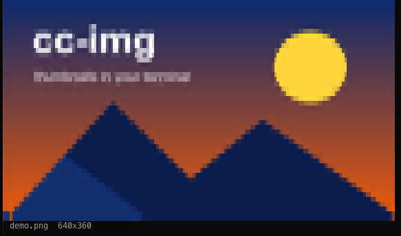
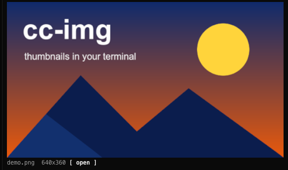

# cc-img

Image thumbnails in the Claude Code transcript. When Claude reads, writes or receives an image, `cc-img` draws a small picture of it under that tool call, in your terminal. Click the picture to open the image in your system's default app.

| Block characters, in any terminal with 24-bit colour | Real pixels, where the terminal draws them |
| --- | --- |
|  |  |

`cc-img` is a Claude Code mod: a plugin that changes Claude Code's own interface. It gives Claude no tool and changes nothing Claude reads. It watches what Claude does and draws the pictures for you.

- [Install](#install)
- [What gets a thumbnail](#what-gets-a-thumbnail)
- [Commands](#commands)
- [Opening an image](#opening-an-image)
- [Terminals](#terminals)
- [Thumbnail size and shape](#thumbnail-size-and-shape)
- [Formats](#formats)
- [What the mod does on your machine](#what-the-mod-does-on-your-machine)
- [If something looks wrong](#if-something-looks-wrong)
- [Things to know](#things-to-know)
- [Tested on](#tested-on)
- [Development](#development)

## Install

At the prompt of a Claude Code session in a terminal:

```
/plugin install cc-img --marketplace dogukanatlihan/cc-img-preview
```

Answer `y` to add the marketplace, then choose a scope. The user scope, the first one, turns the mod on in every session. The mod is active at once, with no restart.

From a shell:

```
claude plugin install cc-img --marketplace dogukanatlihan/cc-img-preview
```

The `--marketplace` option needs Claude Code 2.1.275 or later in a session, and 2.1.292 or later from a shell. On an older version, use two steps:

```
claude plugin marketplace add dogukanatlihan/cc-img-preview
claude plugin install cc-img@cc-img-preview
```

In the desktop app, where `/plugin` does not run: click + next to the prompt box, then Plugins, Add marketplace with `dogukanatlihan/cc-img-preview`, then Add plugin.

| To | Run |
| --- | --- |
| Get a later version | `claude plugin marketplace update cc-img-preview`, then `claude plugin update cc-img@cc-img-preview` |
| Remove the mod | `claude plugin uninstall cc-img@cc-img-preview` |

The mod runs on Windows, macOS and Linux. It was built and tested with Claude Code 2.1.327. On Linux it needs `ffmpeg` or ImageMagick (see [Formats](#formats)).

## What gets a thumbnail

- Image files Claude reads.
- Image files Claude writes, edits, or produces by running a command. A file counts when its path appears in the command or its output and the file changed during the call.
- Pictures that come back from a tool, such as browser or editor screenshots.
- Pictures you paste or attach to a prompt.

At most 4 images are shown per tool call. Tool calls made by subagents are not covered.

Under each picture is the file name and the image's size, for example `shot.png  1280x720`.

## Commands

| Command | What it does |
| --- | --- |
| `/img` | Opens the most recent image. |
| `/img 2` | Opens the one before it, and so on. |
| `/img pixels off` | Draws block characters and sends no picture, in every terminal. `/img pixels on` returns to real pixels. |
| `/img size 40` | Sets how wide a thumbnail may be, in columns, from 8 to 160. It is 80 to start with. |
| `/img fine` | Uses octant blocks, which are sharper and need a font that has them. `/img coarse` returns to quarter blocks. |
| `/img cell 7x17` | Tells the mod the size of one terminal cell, width by height. |

The settings are kept between sessions and apply to thumbnails made after them. [Thumbnail size and shape](#thumbnail-size-and-shape) has the details.

## Opening an image

- **Click the thumbnail.** In block mode the whole picture is clickable. In pixel mode, and for images that could not be drawn, there is an `open` button next to the name. Clicks need Claude Code's fullscreen mode (`"tui": "fullscreen"` in settings).
- **Ctrl+click the file name** (Cmd+click in iTerm2), which is a link the terminal opens itself.
- **Type `/img`.**

## Terminals

| Terminal | Picture |
| --- | --- |
| Any terminal with 24-bit colour (Windows Terminal, VS Code, most others) | Coloured block characters. A thumbnail is at most 80 columns by 40 rows, and smaller where the terminal is. A cell has only two colours, so fine detail blurs. |
| kitty, Ghostty | Real pixels. |
| iTerm2 3.5+ | Real pixels, once you allow them in iTerm2's own dialog (see below). |
| Rex, and other terminals that draw kitty graphics but that Claude Code does not know by name | Block characters to start with. Real pixels after one setting (see below). |
| Windows Terminal 1.22+, directly or inside herdr (not tmux) | Real pixels, by a painter of the mod's own (experimental; see below). |

The mod finds out which kind of terminal it is in by itself, once per session: it sends a one-pixel test picture and sees if the terminal takes it.

### Real pictures in iTerm2

iTerm2 draws real pixels, but it asks the person first. For each picture a program sends, iTerm2 opens the dialog "Allow Terminal-Initiated Display?", and Claude Code stands still until the dialog is answered. The first image brings about three such dialogs, the first of them for the mod's one-pixel test picture ("Unnamed file", 70 bytes). The mod says so once, the first time it starts in iTerm2.

You have two ways to stop the dialogs:

- Tick "Remember my choice" in the dialog and press Yes. Know what that tick does before you set it: iTerm2 keeps one answer for pictures and for file downloads that a program in the terminal starts, so after the tick it asks for neither. To take it back: iTerm2 Settings, Advanced, "Suppress confirmation of terminal-initiated downloads".
- Type `/img pixels off`. The mod then draws block characters and sends no picture.

If you answer No and tick "Remember my choice", the picture area stays empty, and the mod cannot see that. Go to blocks with `/img pixels off`.

The mod knows iTerm2 by the `TERM_PROGRAM` and `LC_TERMINAL` variables. It uses them only to say the above once. Where neither reaches Claude Code (over ssh with no `LC_*` variables sent on, or in a tmux server started from another terminal), the dialogs come with no word from the mod.

### Real pictures in Rex

Rex draws kitty graphics, Unicode placeholders included, which is the way Claude Code draws a mod's picture. But Claude Code draws that way only in the terminals it knows by name (kitty and Ghostty), so in Rex the mod's test picture is refused and you get block characters.

Claude Code has a switch for such a terminal: the environment variable [`CLAUDE_CODE_FORCE_TERMINAL_IMAGES`](https://code.claude.com/docs/en/env-vars). Claude Code reads it when it starts, so the mod cannot set it for you. Set it for Rex alone, in `~/.zshenv` (or the file your shell reads for every shell):

```
if [[ $TERM_PROGRAM == rex && -z $TMUX && -z $STY ]]; then
  export CLAUDE_CODE_FORCE_TERMINAL_IMAGES=1
fi
```

Then open a new Rex pane and start Claude Code there. Do not set the variable for every terminal: in one that draws no kitty placeholders you get a box in place of each picture. That is also why the lines leave out tmux and GNU screen.

The same lines, with the other terminal's `TERM_PROGRAM`, work for any terminal that draws kitty graphics with Unicode placeholders. In Rex a transparent picture keeps its transparent parts.

### Real pictures in Windows Terminal (experimental)

Windows Terminal draws pictures only as Sixel, and Claude Code gives a mod no way to send Sixel. So here the mod goes around Claude Code:

- Under the tool call it draws the block-character thumbnail, and hides a marker in the first five cells of each row.
- It starts one background process for the session (`helpers/sixel.ps1`, about 90 MB), which reads Claude Code's screen, finds the markers, and paints the picture over those rows itself. It ends when Claude Code does.
- The picture itself takes no click: a button redraws under the pointer, which wipes the picture there. Open the image with the `open` button beside its name, or `/img`.

What to expect: the block thumbnail is what Claude Code itself draws, so it moves with the text; the painter then covers it with the real picture, a frame or two later. While you scroll, the picture is therefore coarse for a moment at each step and sharp again when it rests. The painter looks at the screen every 3 ms while pictures move, every 12 ms while they stand still. Where the painter does not run, the block thumbnail stays.

The marker cells hold braille characters in the colour of the picture beneath them. Copying text across a picture copies the block and braille characters too.

Inside tmux the mod always uses blocks: tmux passes no Sixel on.

Inside herdr the painter works past herdr, which passes no Sixel on either. It paints on the screen of the herdr window itself, which is Windows Terminal's: it finds the picture rows wherever herdr has put the pane and paints there. One painter runs per herdr window and paints the pictures of every pane in it. If the herdr window does not run in Windows Terminal, or there is none on this machine, the mod uses blocks.

## Thumbnail size and shape

Block characters come in two kinds, and the mod cannot tell which your font has, so you choose:

| Command | Blocks | "Pixels" a cell | Largest thumbnail | Needs |
| --- | --- | --- | --- | --- |
| `/img coarse` (the default) | Quarter blocks | 2 across, 2 down | 160 by 80 | Nothing: every font has them. |
| `/img fine` | Octant blocks | 2 across, 4 down | 160 by 160 | A font with Unicode 16's octants, such as the Cascadia Mono that Windows Terminal 1.22 and later ships. |

`/img size 40` sets how wide a thumbnail may be, in columns. A thumbnail is at most half as many rows tall. A "pixel" can be no smaller than a block: half a cell wide, and a half or a quarter of a cell tall. So a smaller thumbnail holds fewer pixels, and the only way to get the same picture smaller is a smaller terminal font.

`/img cell 7x17` tells the mod the size of one terminal cell, width by height. The mod cannot ask the terminal, and takes a cell for twice as tall as wide (`1x2`). With a taller line spacing a thumbnail then looks stretched from top to bottom, and a real picture has empty rows under it. Only the shape counts, so any unit does. Most terminals print the size for this line in bash or zsh:

```
printf '\033[16t'; IFS=';' read -rs -d t _ h w; echo "${w}x${h}"
```

The mod keeps one cell size for all terminals. If you use two terminals with different cell shapes, set it again when you change.

## Formats

| System | Works with nothing installed | Needs `ffmpeg` or ImageMagick |
| --- | --- | --- |
| Windows | png, jpg, gif, bmp, tif, ico | webp, avif |
| macOS | png, jpg, gif, bmp, tif, heic, heif; on a newer macOS also webp (from macOS 11), avif (from macOS 13) and ico | webp, avif and ico on an older macOS |
| Linux | none | all of them |

SVG needs ImageMagick or `rsvg-convert`. On Windows and Linux, HEIC (`.heic`, `.heif`) needs ImageMagick built with HEIC support; `ffmpeg` is not used for it, because an `ffmpeg` before 7.0 shows only one tile of a phone's photo. An image that nothing on the machine can read still gets its name and an `open` button, with no picture.

## What the mod does on your machine

- **No network.** The mod sends nothing anywhere. It makes each thumbnail on your machine, with a program that is already there: `sips` on macOS, PowerShell on Windows, `ffmpeg`, ImageMagick or `rsvg-convert` where you installed them.
- **Nothing changes for Claude.** The mod adds no tool, and changes no tool call, no result and no prompt.
- **A click opens only images.** Only image files the mod recorded itself can be opened, so a click never starts a program or a script. A file name that turns out to be a link to something that is not an image is not shown and not opened.
- **Only local paths.** Image paths found in a command's text are only looked at on this machine: a network path (`\\host\share\a.png`) in tool output is ignored, unless Claude itself read that file.
- **Temporary files.** Thumbnails, and pictures that have no file of their own (tool screenshots and pasted images), are saved to `<temp folder>/cc-img/`. Folders there are deleted after 7 days.
- **Environment variables it reads:** `TERM_PROGRAM`, `LC_TERMINAL`, `WT_SESSION`, `TMUX`, `HERDR_ENV`, `HOME`, and the temp folder's (`TMPDIR`, `TEMP`, `TMP`).

## If something looks wrong

| You see | Do this |
| --- | --- |
| Boxes or question marks where the picture should be, after `/img fine` | The font lacks octants. Go back with `/img coarse`. |
| A box in place of each picture | `CLAUDE_CODE_FORCE_TERMINAL_IMAGES` is set in a terminal that draws no kitty placeholders. Unset it there. |
| An empty picture area in iTerm2 | iTerm2 was told No with "Remember my choice". Use `/img pixels off`, or take the choice back in iTerm2's settings. |
| A thumbnail stretched from top to bottom, or empty rows under a real picture | Set the cell size: `/img cell`, see [Thumbnail size and shape](#thumbnail-size-and-shape). |
| A name and an `open` button, but no picture | Nothing on the machine reads that format. See [Formats](#formats). |
| Block characters in a terminal that draws kitty graphics | Claude Code does not know the terminal by name. See [Real pictures in Rex](#real-pictures-in-rex). |
| A click does nothing | Clicks need Claude Code's fullscreen mode. `/img` works without it. |

## Things to know

- A pasted image opens as the resized copy Claude Code made of it, not your original file.
- The mod keeps pictures for the 40 most recent images. Older rows keep their name and can still be opened.
- A pasted image is matched to your message by the message's text. Two messages with exactly the same text, sent before the first one's thumbnail has appeared, can swap pictures.
- A relative path in a command is resolved against the folder the session started in. On macOS and Linux a path that starts with `~/` is resolved against your home folder, and a space written as `\ ` is read as part of the path.
- A path with spaces is found only where it is quoted or its spaces are escaped. A bare `my shot.png` in a command's output is read as two words.
- In block characters on macOS, the clear parts of a picture are drawn black; with ImageMagick they are drawn grey.
- A thumbnail keeps the width it was made at. Narrow the terminal afterwards and it is cut off at the right edge; widen it and it stays small.
- `/img cell` is not applied to the Windows painter.
- The box is two constants, `MAX_COLUMNS` and `MAX_ROWS`, in `hooks/pixels.ts`.

## Tested on

| System and terminal | Seen working on screen |
| --- | --- |
| Windows 11, Windows Terminal 1.25 | Block thumbnails and the Sixel painter, both directly and inside herdr 0.9.5. The Windows helper and the `ffmpeg` path have been run on real files. |
| macOS 27, iTerm2 3.7.7, Claude Code 2.1.327 | Block thumbnails for files Claude read and files a command wrote (png, jpg, webp, names with escaped spaces), a click on a thumbnail, `/img`, `/img cell 7x17`, and real pixels after a Yes in iTerm2's dialogs. The `sips` commands have been run by hand on png, jpg, gif, bmp, tif, webp, avif and ico files. |
| macOS 27, Rex Beta 0.1.0 | Block thumbnails, and real pixels with `CLAUDE_CODE_FORCE_TERMINAL_IMAGES=1`, the first picture of a session included, and the thumbnail of a HEIC file a command wrote. The two pictures at the top of this page were taken there. |

Not yet run on a real machine or terminal: Linux, kitty and Ghostty, pasted images and tool screenshots on macOS, the file name link, and octant blocks on macOS.

If you run the mod somewhere that is not in this table, an [issue](https://github.com/dogukanatlihan/cc-img-preview/issues) that says what you saw is welcome, whether it worked or not.

## Development

Load the mod into a session from a clone of this repository:

```
claude --plugin-dir <this folder>
```

Then, from this folder:

```
claude plugin validate .
claude plugin test .
npx -y -p typescript tsc -p .
```

The type check needs the types Claude Code writes into `.claude-plugin/types/` when it loads the mod from this folder: start one session with `--plugin-dir` first.

| Path | Holds |
| --- | --- |
| `hooks/register.tsx` | The mod: what it hooks, the work queue, the `/img` command. |
| `hooks/collect.ts`, `hooks/paths.ts` | Which images a tool call touched. |
| `hooks/thumb.ts`, `hooks/work.ts` | Making a thumbnail with the system's own programs. |
| `hooks/pixels.ts`, `hooks/draw.tsx` | Pixels to block characters, and what is drawn under a row. |
| `helpers/` | The Windows thumbnail helper and Sixel painter. |
| `hooks/*.test.ts`, `hooks/*.test.tsx` | The tests. |

The design is in `docs/superpowers/specs/`, the build plan in `docs/superpowers/plans/`, and every decision made since, with its reason, in `.superpowers/sdd/2026-11-17-cc-img/progress.md`. The versions are in [CHANGELOG.md](CHANGELOG.md).

The Windows painter logs to `%TEMP%\cc-img\sixel.log`. A file named `debug` in `%TEMP%\cc-img` makes a newly started painter log every move too.

## Credits and license

Inspired by [hood/claude-kitty-image](https://github.com/hood/claude-kitty-image), which gives Claude a tool to show pictures on purpose.

[MIT](LICENSE).
